# QuickLook Manager

**Italiano** · [English](README.en.md)

Quick Look di macOS mostra anteprime e miniature di molti tipi di file, ma non di quelli che servono davvero a chi sviluppa, stampa in 3D o fotografa. **QuickLook Manager** ne riunisce un'intera serie in un'unica app: premi Spazio su un file di codice, una nota Markdown, un'app, uno ZIP, un video MKV, una foto RAW, un file per la stampa 3D, un disegno EPS o un pacchetto di installazione e vedi cosa contiene.

Tutto è incorporato nell'app: non c'è niente da installare oltre all'app stessa. **Copiala in Applicazioni** e macOS attiva da solo le sue estensioni Quick Look.

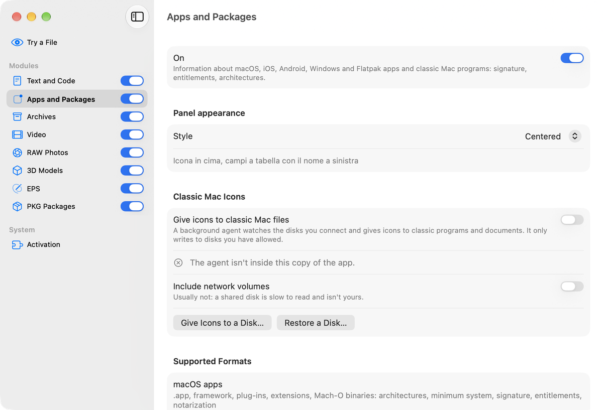

La finestra è un pannello di controllo: a sinistra i moduli, ciascuno con il suo interruttore; a destra le impostazioni del modulo scelto. «Prova un file» permette di trascinare qualunque file per vedere esattamente cosa mostrerà Quick Look.

## Moduli

| Modulo | Cosa mostra |
|---|---|
| **Testo e codice** | Codice colorato (oltre 190 linguaggi), JSON/YAML/plist ad albero con vista sorgente, Markdown (Typora, GitHub, CommonMark, MultiMarkdown) con formule, diagrammi, note a piè di pagina e temi importabili; anche Textile, AsciiDoc, Creole, reStructuredText, BBCode e pagine man. |
| **App e pacchetti** | App macOS, iOS, Android, Windows e Flatpak: identificatore, versione, architetture, sistema minimo, firma, entitlement, provisioning. Programmi e documenti dei Mac classici, con le loro icone originali. |
| **Archivi** | Il contenuto di ZIP, 7z, RAR, tar, gz, bz2, xz, cpio, CAB, ISO, XAR, RPM, DEB… ad albero, senza estrarlo. |
| **Video** | Un lettore integrato per i formati che macOS non conosce: MKV, WebM, AVI, WMV, FLV, M2TS, VOB… Parte all'apertura di Quick Look e si ferma alla chiusura. Anche le miniature. |
| **Foto RAW** | Anteprime e miniature per Canon, Nikon, Sony, Fujifilm, Olympus, Panasonic, Pentax, Leica, Adobe DNG e molti altri. |
| **Modelli 3D** | Anteprima 3D interattiva dei file 3MF (ruota, ingrandisci, piatti di stampa) e miniature. |
| **EPS** | Anteprime e miniature dei disegni EPS, con l'immagine incorporata o con Ghostscript. |
| **Pacchetti PKG** | In alto identificatore, versione, script e firma; in basso l'elenco completo dei file che installa, letto dalla distinta del pacchetto: è immediato anche con pacchetti da gigabyte. |

## Schermate

| | |
|---|---|
| 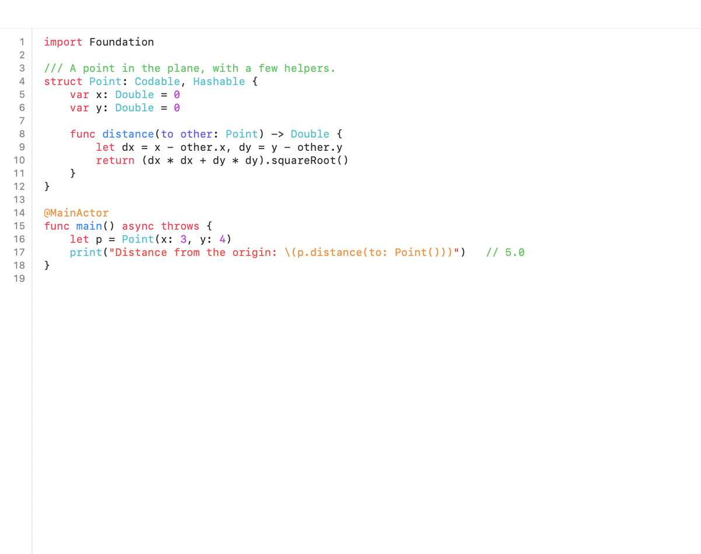 | 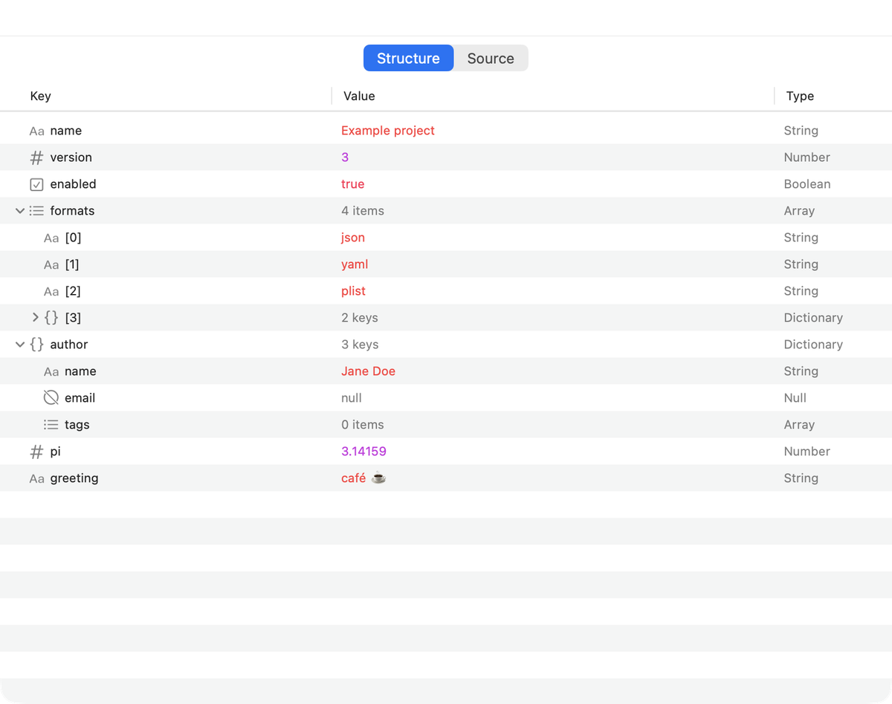 |
| 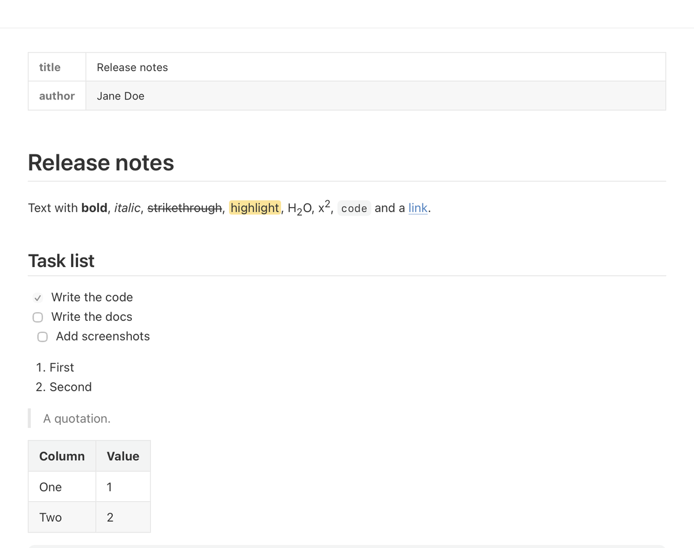 | 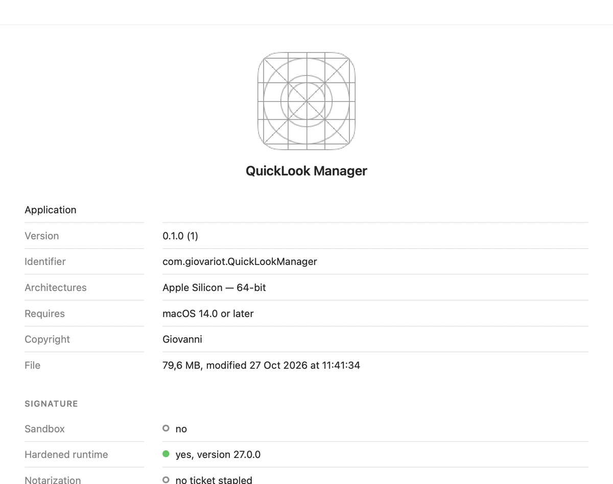 |
| 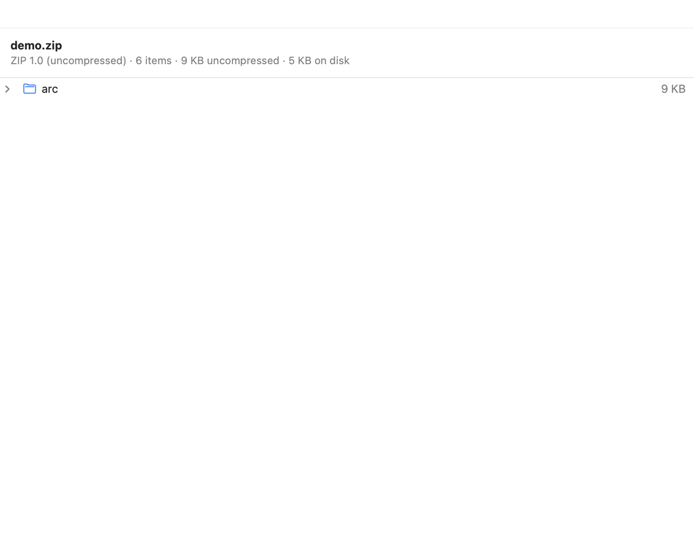 | 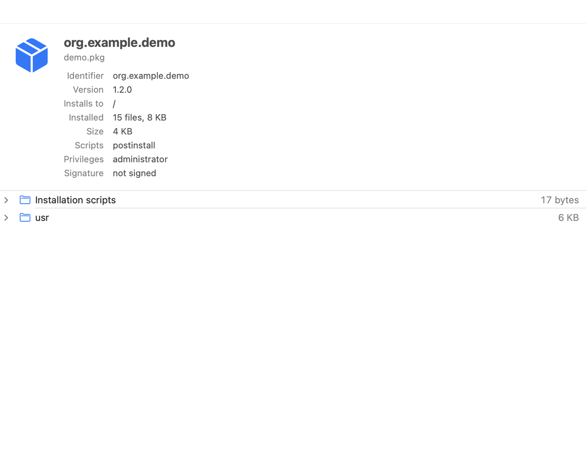 |
| 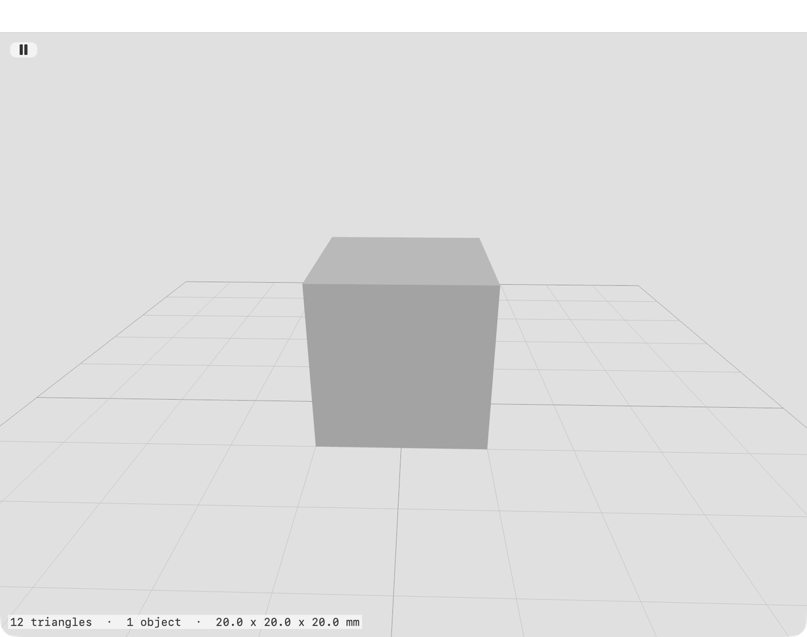 | 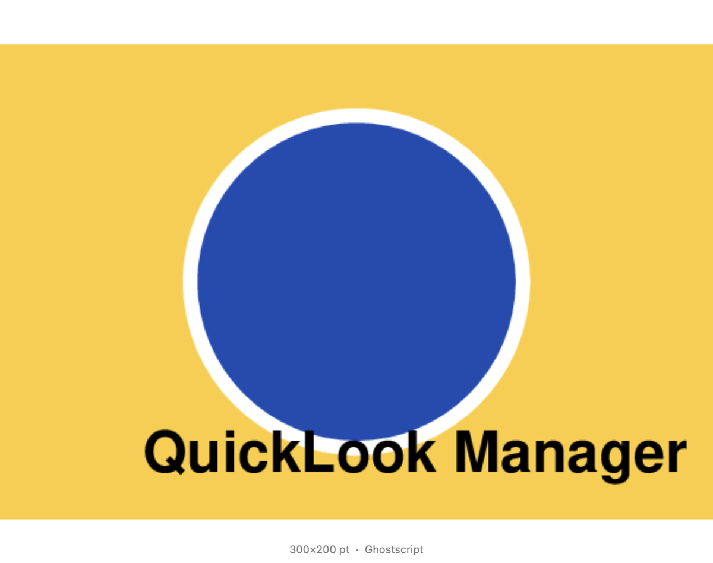 |

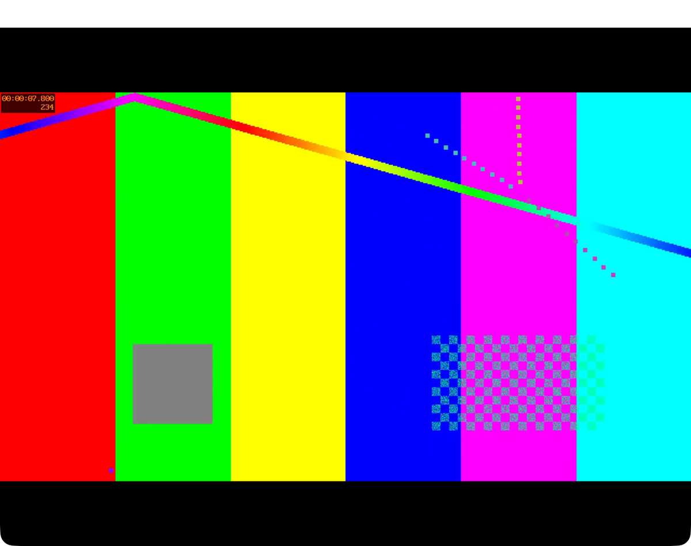

## Lingue

L'app è disponibile in **italiano, inglese, francese, tedesco, spagnolo e arabo** (anche da destra a sinistra) e segue la lingua del Mac.

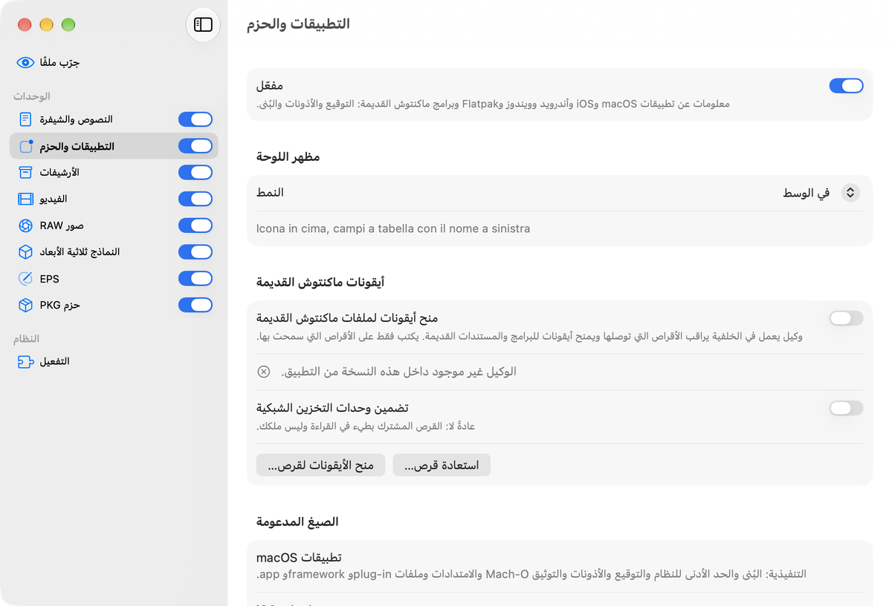

## Requisiti e installazione

- macOS 14 o successivo, Apple Silicon.
- Scarica l'app dalle [release di GitHub](../../releases), spostala in **Applicazioni** e aprila una volta.
- Se un'altra app fornisce già le anteprime degli stessi tipi di file (per esempio QuickTextLook, QLAppBundle, QuickLook Video, Camera RawX o Preview3MF), Quick Look ne sceglie una sola. Togli le app doppie o spegni la loro estensione in Impostazioni di Sistema › Elementi di login ed estensioni. La pagina *Attivazione* dell'app lo spiega.

## Compilare

```bash
python3 scripts/gen-types.py   # tipi (UTI) → project.yml e Kit/QLMTypes.swift
xcodegen generate
xcodebuild -project QuickLookManager.xcodeproj -scheme QuickLookManager \
           -configuration Debug -derivedDataPath build/DerivedData build
```

Prima del primo build, una volta: `scripts/vendor-ghostscript.sh` (modulo EPS) e `scripts/vendor-video.sh` (modulo Video) scaricano i sorgenti e li compilano in `Vendor/` (ignorato da git). Il build li incorpora con `scripts/embed-ghostscript.sh` e `scripts/embed-video-libs.sh`. Il bundle JavaScript del modulo testo è già in `Modules/Text/Resources/Web`; per rigenerarlo: `cd tools/js && npm install && ./build.sh`.

Le traduzioni stanno in `scripts/traduzioni/`; dopo il build, `scripts/gen-strings.py` rigenera i String Catalog e segnala ciò che manca.

Prove che non registrano niente nel sistema (solo Debug): `QuickLookManager -QLMRender <file> <png>` and `-QLMSnapshot <png> [-QLMPane try|text|apps|archives|video|raw|models|eps|pkg|activation]`.

## Licenza e crediti

QuickLook Manager è rilasciato con licenza **GNU GPL v3** (vedi [LICENSE](LICENSE)) e distribuito solo tramite GitHub. Si appoggia al lavoro di altri:

- [QLAppBundle](https://github.com/relikd/QLAppBundle) by relikd (MIT) — App e pacchetti;
- [Preview3MF](https://github.com/cavoco/Preview3MF) by Cavan O'Connor (MIT) — modelli 3D;
- [QLVideo](https://github.com/Marginal/QLVideo) by Jonathan Harris (GPL 2+) — versioni e patch di ffmpeg;
- [LibRaw](https://github.com/LibRaw/LibRaw), [Ghostscript](https://ghostscript.com) (AGPL v3), [FFmpeg](https://ffmpeg.org), [dav1d](https://code.videolan.org/videolan/dav1d), [zimg](https://github.com/sekrit-twc/zimg), ZIPFoundation, AndroidXML, highlight.js, markdown-it, KaTeX, Mermaid and others.

L'elenco completo, con le licenze, è in [THIRD_PARTY_NOTICES.md](THIRD_PARTY_NOTICES.md).
